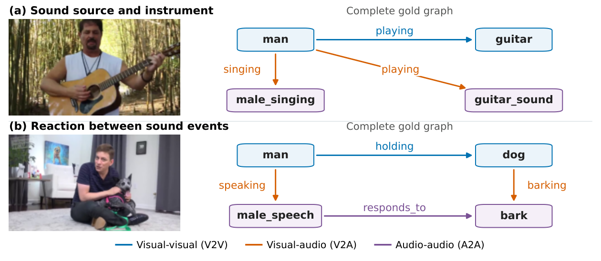
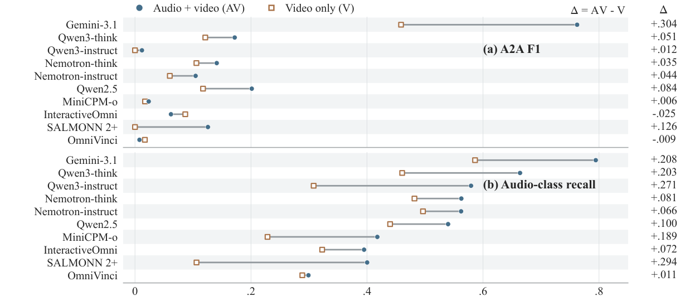
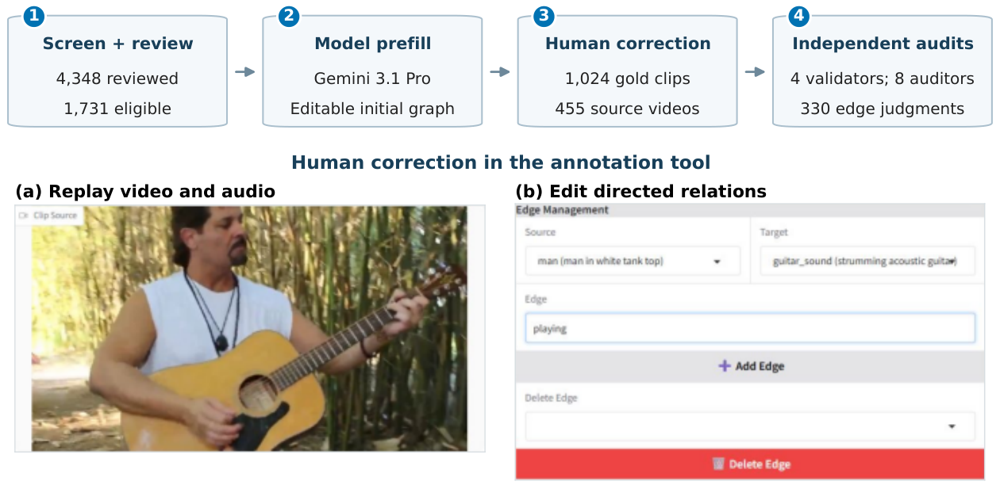

# AVSG: Benchmarking Audio–Visual Scene Graph Generation

**A benchmark for generating graphs of visible entities, sounds, and their relationships from video and audio.**

[Dataset](docs/dataset.md) · [Evaluation](docs/evaluation.md) · [Reproduce results](docs/reproduction.md) · [Model protocols](docs/model_protocols.md) · [Citation](CITATION.cff)

AVSG contains **1,024 human-corrected clips from 455 source videos**, with explicit visual and audio nodes and three relation families: visual–visual (V2V), visual–audio (V2A), and audio–audio (A2A). The benchmark reports graph accuracy alongside score changes when audio is removed.



## Dataset at a glance

| Property | Value |
|:--|--:|
| Clips / source videos | 1,024 / 455 |
| Total duration / median clip duration | 7.96 hours / 14.0 seconds |
| Nodes / edges | 5,297 / 4,433 |
| Visual / audio classes | 74 / 36 |
| Allowed modality-typed relations | 53 |
| Source-disjoint train / test clips | 827 / 197 |

The clips form an audio-salient subset of LongVALE. Annotations, clip identifiers, timestamps, and split indices are included; source videos are not redistributed. See the [dataset documentation](docs/dataset.md) for the schema, provenance, and media acquisition.

## Quickstart

Python 3.10 or later is required. Scoring saved graph predictions uses the Python standard library and does not need a GPU or video downloads.

```bash
git clone https://github.com/Wang-Yuanqing/AVSG-Audio-Visual-Scene-Graphs-Measure-What-Omni-Modal-Models-Actually-Hear.git
cd AVSG-Audio-Visual-Scene-Graphs-Measure-What-Omni-Modal-Models-Actually-Hear

# Score a saved full-corpus prediction file.
python -m evaluation.score --predictions results/predictions/main/gemini-3.1-pro_raw.jsonl --split full

# Regenerate the benchmark tables from the released predictions.
python -m evaluation.reproduce --output-dir results/tables
```

The first command reproduces Gemini-3.1-Pro's **ALL micro-F1 of 0.692**. To evaluate your own model, write one graph per clip using the [prediction format](docs/evaluation.md), then pass that JSONL file to the same scorer. Use `--split test` for the official 197-clip held-out evaluation.

## Results

Raw inputs contain video and audio, without the reference caption. All rows below evaluate the same 1,024 clips. ALL pools node and edge counts before computing micro-F1.

| Model configuration | Node | V2V | V2A | A2A | ALL |
|:--|--:|--:|--:|--:|--:|
| Gemini-3.1-Pro | .781 | .494 | .663 | .762 | .692 |
| Gemini-2.5-Pro | .777 | .504 | .662 | .668 | .692 |
| Gemini-3.5-Flash | .775 | .490 | .634 | .702 | .685 |
| Qwen3-Omni-Thinking | .715 | .378 | .602 | .172 | .608 |
| Nemotron-Omni-Thinking | .662 | .348 | .520 | .141 | .550 |
| Qwen3-Omni-Instruct | .635 | .222 | .459 | .012 | .491 |
| Qwen2.5-Omni | .568 | .146 | .370 | .201 | .418 |
| Nemotron-Omni-Instruct | .501 | .184 | .328 | .104 | .396 |
| InteractiveOmni | .417 | .068 | .181 | .062 | .280 |
| MiniCPM-o | .318 | .115 | .305 | .024 | .265 |
| video-SALMONN 2+ | .371 | .102 | .129 | .126 | .254 |
| OmniVinci | .381 | .032 | .124 | .008 | .250 |

The release also includes caption-conditioned predictions, video-only predictions, and LoRA predictions on the held-out split. See [reproduction](docs/reproduction.md) for complete tables, confidence intervals, and paired analyses. Full-corpus prompted scores and held-out adaptation scores use different cohorts and should be compared within their respective tables.



Removing audio measures **score sensitivity under the evaluated input protocol**. It does not identify the fraction of relations caused by hearing. The scorer compares class-typed structure, ignores free-text attributes, and can accept swaps between instances of the same class. See [evaluation scope](docs/evaluation.md).

## Construction and quality checks



Human annotators corrected Gemini-3.1-Pro prefills using the released rubric. In the separate blinded edge audit, eight non-author volunteers supplied 330 judgments on 135 edges, with two or three raters per edge. Of 114 sampled gold edges, 106 were unanimously judged correct by their assigned raters; the design-weighted acceptance rate is 91.0%. Incorrect and uncertain judgments both count as non-acceptance. This is sampled reference correctness, not a human graph-generation ceiling.

## Repository

| Directory | Contents |
|:--|:--|
| `data/` | Gold graphs, rubric, vocabulary, clip manifest, splits, and anonymized quality evidence |
| `evaluation/` | Archived metric, historical prompt, parser, and cohort-aware scoring |
| `results/` | Paper-matched predictions, regenerated tables, and analysis outputs |
| `analysis/` | Statistical analyses and reproducibility commands |
| `inference/` | Model inference sources and environment documentation |
| `training/` | LoRA training sources and configuration |
| `annotation/` | Annotation tools and usage instructions |
| `examples/` | Small graph examples |
| `docs/` | Dataset, metric, protocols, and reproduction documentation |

## Citation and attribution

Use [CITATION.cff](CITATION.cff) to cite this software/data release. The repository accompanies **AVSG: Benchmarking Audio–Visual Scene Graph Generation**. Source clip boundaries and captions come from [LongVALE](https://github.com/ttgeng233/LongVALE), which should also be credited when using those resources.

See [LICENSE](LICENSE) for code, annotations, and third-party material. Model outputs are included to reproduce the reported evaluation; model weights and source videos are not bundled.
