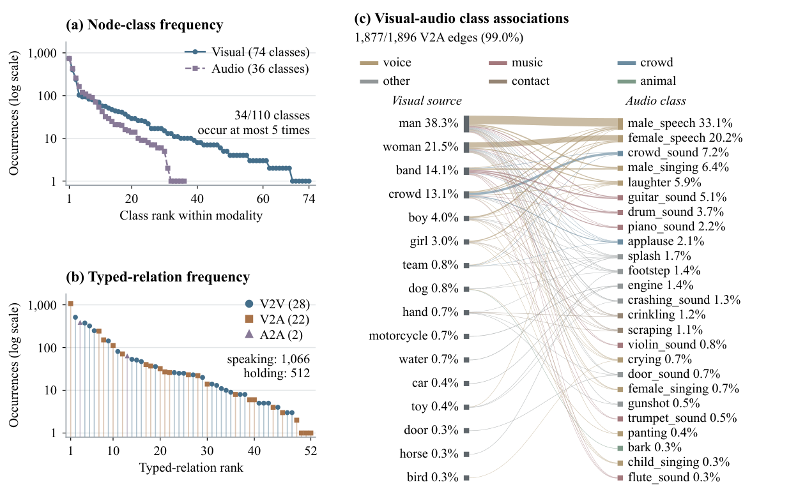

# Dataset

AVSG contains 1,024 human-corrected audio-visual scene graphs from 455 source videos. The 7.96-hour corpus is an audio-salient subset of LongVALE, rather than a random sample of web video. Clips have a median duration of 14.0 seconds; some are substantially longer.

## Files

- `data/gold/1k_result.jsonl`: canonical annotations, one JSON object per clip.
- `data/rubric.md`: the annotation guideline, vocabulary, substitutions, and relation rules.
- `data/splits/split_v1.json`: official split by source video.
- `data/splits/test_clips.txt`: the 197 held-out clip filenames.
- `data/validation/`: anonymized original graph-validation study.
- `data/audit/`: anonymized additional edge-audit evidence and sampling information.

## Record format

```json
{
  "filename": "<source_video_id>_<start_seconds>_<end_seconds>.mp4",
  "caption": "Reference event caption from LongVALE",
  "ground_truth_nodes": [
    {"id": "v1", "class": "man", "attribute": "person playing a guitar"},
    {"id": "a1", "class": "guitar_sound", "attribute": "audible guitar"}
  ],
  "ground_truth_edges": [
    {"source": "v1", "edge": "playing", "target": "a1"}
  ]
}
```

This is a schema illustration, not an additional dataset record. Node IDs are local to each clip. The `v` prefix denotes visual nodes and `a` denotes audio nodes. Free-text attributes describe instances; the evaluation metric ignores them. Symmetric relations (`next_to`, `playing_with`, `in_dialogue_with`) are stored once and matched without regard to endpoint order.

The rubric defines 74 visual classes, 36 audio classes, and 53 modality-typed relations. Of these, all 110 node classes and 52 typed relations occur in the released gold. A relation name shared by two modality families is counted separately in the typed vocabulary. Background music, background sound, and sound effects remain isolated nodes.

## Evaluation cohorts

| Use | Clips | Source videos |
|:--|--:|--:|
| Untuned full-corpus benchmark | 1,024 | 455 |
| LoRA training | 827 | 364 |
| Held-out adaptation evaluation | 197 | 91 |

The training and test source-video sets are disjoint. Full-corpus prompted evaluation is not a held-out score for models trained on the 827 training clips. Caption-conditioned evaluation additionally supplies the reference caption and is reported separately from raw video/audio evaluation.

## Media acquisition

Videos are not included. Parse clip filenames from the right into a source video ID, start time, and end time; video IDs may themselves contain underscores. Obtain permitted copies of the corresponding sources, then cut clips at the provided timestamps. Preserve the original audio and video synchronization.

For a source video already available locally:

```bash
ffmpeg -ss START_SECONDS -i source.mp4 -t DURATION_SECONDS -c:v libx264 -c:a aac -crf 18 -preset veryfast CLIP_FILENAME.mp4
```

Here `DURATION_SECONDS = END_SECONDS - START_SECONDS`. Video-only inputs should retain the same video while removing its audio track:

```bash
ffmpeg -i CLIP_FILENAME.mp4 -c:v copy -an VIDEO_ONLY_FILENAME.mp4
```

Some source videos may become unavailable. Keep a record of missing media and the evaluated cohort; scoring the released saved predictions does not require reacquiring media. The repository does not grant rights to the source videos or supersede LongVALE's or the source platform's terms.

## Provenance and quality

Model screening was followed by human eligibility review, Gemini-3.1-Pro prefills, and human graph correction. Of 1,731 eligible clips, 1,024 received completed annotations within the available time. This selection is part of the benchmark's scope.

Four independent validators accepted 224 of 236 shown-graph judgments (94.9%). The later edge audit involved eight non-author student volunteers with no research collaboration with the authors. They had neither annotated gold nor seen original prefills. All gave informed consent and were unpaid. Model/gold provenance and others' answers were hidden, and no default or target acceptance rate was supplied.

The edge audit sampled 12 clips from each of the A2A-present and A2A-absent strata. It contains 114 gold edges and 21 unmatched model edges, totaling 330 judgments. Gold acceptance requires unanimity, including uncertain judgments in the denominator. The design-weighted gold acceptance rate is 91.0%; the unweighted count is 106/114. These checks assess the shown references, not complete graph recall or a human ceiling.


